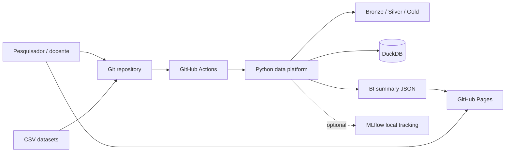
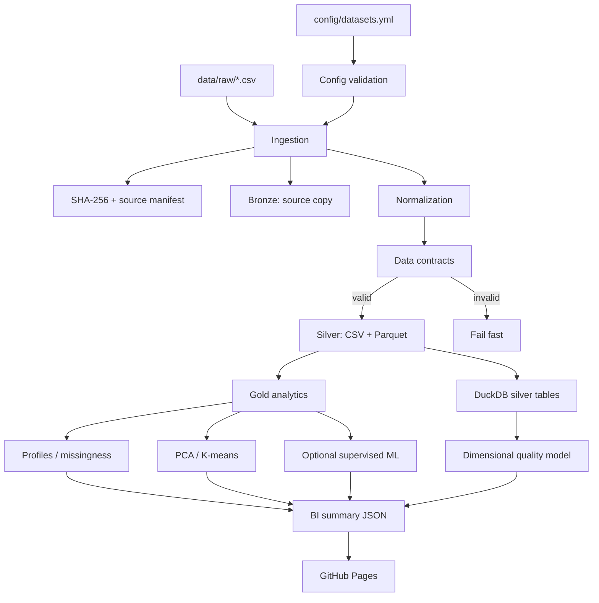

# Arquitetura da Plataforma

## 1. Objetivo e escopo

A plataforma transforma conjuntos CSV usados em estudos de Estatística Multivariada em produtos de dados reprodutíveis. O desenho privilegia transparência metodológica, rastreabilidade, simplicidade operacional e baixo custo de execução.

O sistema atual é **batch, file-based e single-node**. GitHub Actions fornece o ambiente de execução automatizada; DuckDB é o motor analítico embarcado; GitHub Pages publica a interface estática de BI.

## 2. Contexto (C4 — nível 1)

## 3. Containers e responsabilidades (C4 — nível 2)

| Container | Tecnologia | Responsabilidade |
|---|---|---|
| Source control | Git/GitHub | Versionar código, configuração e fontes didáticas |
| Orchestration | GitHub Actions | CI, execução batch agendada e deploy |
| Ingestion & transformation | Python, pandas, PyArrow | Ler CSV, normalizar, validar, produzir CSV/Parquet |
| Analytical methods | scikit-learn | Perfilamento numérico, PCA, K-means e classificação opt-in |
| Analytical warehouse | DuckDB | Persistir tabelas Silver e fatos/dimensões de qualidade |
| Presentation contract | JSON | Expor resumo estável ao dashboard |
| BI frontend | HTML/CSS/JavaScript | Consumir JSON estático e apresentar indicadores |
| Experiment tracking | MLflow (opcional) | Registrar parâmetros, métricas e artefatos de experimentos supervisionados |

## 4. Fluxo lógico

## 5. Camadas de dados

### Raw — fonte de entrada
Arquivos de origem em `data/raw/`. Devem ser tratados como entradas: o pipeline não deve alterar seu conteúdo. O inventário e a semântica são mantidos em `config/datasets.yml`.

### Bronze — preservação e lineage
Cópia byte a byte do CSV de origem e hash SHA-256 calculado a partir da fonte. Permite comparar o conteúdo recebido com a execução e investigar alterações. Bronze não é uma camada de limpeza.

### Silver — representação analítica normalizada
Cabeçalhos e valores textuais passam por normalização leve; infinitos são convertidos em ausentes. Cada dataset é exportado em CSV e Parquet. Os dados também são registrados como tabelas `silver_<dataset>` no DuckDB.

### Gold — produtos de consumo
Perfis descritivos, missingness, scores/loadings de PCA, atribuições de cluster, importância de atributos e métricas supervisionadas quando habilitadas. `bi_summary.json` é o contrato de publicação consumido pelo frontend.

## 6. Modelo analítico

O arquivo `data/gold/analytics.duckdb` contém:
- `silver_<dataset>`: tabelas de dados normalizados;
- `dim_dataset`: identificação do dataset e atributos estruturais;
- `dim_run`: metadados da execução;
- `fact_data_quality`: métricas de qualidade por dataset e execução;
- `bi_dataset_quality`: view de consumo para indicadores de qualidade.

O modelo dimensional atual é deliberadamente enxuto e orientado à observabilidade da qualidade. Não é ainda um data mart histórico completo: as tabelas são recriadas no pipeline atual. Histórico persistente de execuções é uma evolução futura.

## 7. Fronteiras e contratos

- YAML descreve quais fontes participam da execução e suas regras.
- CSV é o formato de intercâmbio e origem.
- Parquet é o formato colunar de consumo analítico.
- DuckDB é o contrato SQL local.
- JSON é a interface entre backend analítico e dashboard.
- Os scripts R originais são materiais metodológicos preservados; não são executados automaticamente pelo pipeline Python.

Alterar o schema do JSON exige atualizar o produtor, os consumidores e os testes na mesma mudança.

## 8. Confiabilidade e falhas

A execução falha quando a configuração está ausente/inválida, uma fonte configurada não existe, a leitura falha, um contrato com `fail_on_error: true` é violado ou um target supervisionado explicitamente configurado não existe/é inviável.

Os artefatos devem ser considerados válidos apenas quando o job termina com sucesso. A publicação Pages depende do sucesso do build.

## 9. Segurança e limites

- Não inserir dados pessoais, clínicos identificáveis, segredos ou credenciais nas fontes versionadas.
- Dados e artefatos são publicados em repositório e Pages públicos; revisar conteúdo antes de adicionar datasets.
- MLflow usa armazenamento local no runner/repositório de execução e não constitui registry remoto ou serviço multiusuário.
- GitHub Actions é o orquestrador atual; não há scheduler interno nem execução contínua.
- DuckDB é embarcado, não um serviço de banco de dados multiusuário.

## 10. Evolução arquitetural

Próximos degraus, em ordem sugerida:
1. schema JSON Schema validado em CI para configuração;
2. versionamento explícito do contrato do JSON e migrações;
3. execução transacional/atômica com staging e promoção de artefatos;
4. histórico de runs e fatos append-only;
5. qualidade avançada e detecção de drift;
6. ingestão incremental e particionamento Parquet;
7. orquestração externa somente quando volume/frequência justificar;
8. registry remoto de modelos e avaliação temporal quando houver casos supervisionados definidos.
